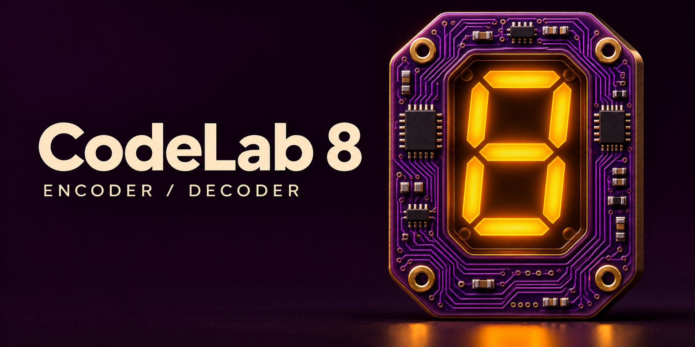
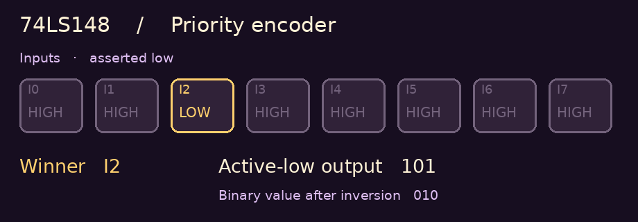

# CodeLab 8

**Priority Encoder & Decoder Trainer Board** · Abdelrahman Ahmed Saleh

## Which input wins?

Watch **I2** stay low throughout the animation. As soon as **I5** also goes low, the enabled 74LS148 selects I5 because it has higher priority. Its three output pins read `010`. Inverting those bits gives `101`, the binary value of 5.

## Trace the same number through three chips

| Chip | Example input | What to look for |
| --- | --- | --- |
| 74LS148 priority encoder | I2 and I5 low, other inputs high, encoder enabled | I5 wins. The active-low output code is 010. |
| 74LS138 decoder | Address 101, decoder enabled | Y5 goes low. The other seven outputs stay high. |
| 7447 display driver | BCD 0101 in normal display mode | Segments a, c, d, f and g form the digit 5. |

The table uses 5 as a common example for each chip. Follow the board wiring, including the 74LS04 inverters, in the [circuit schematic](coder.pdf).
